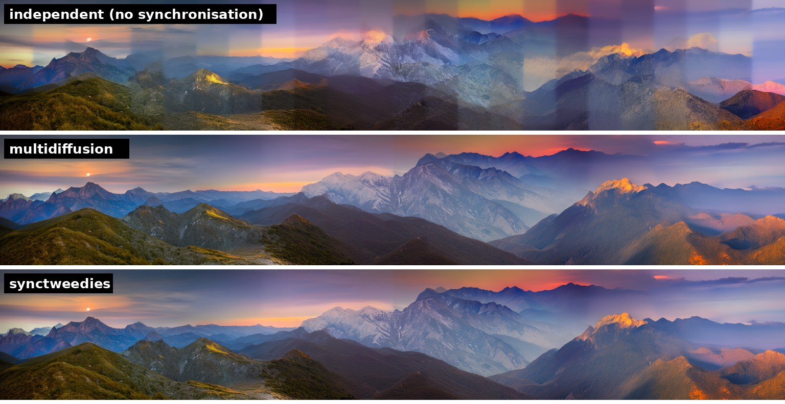
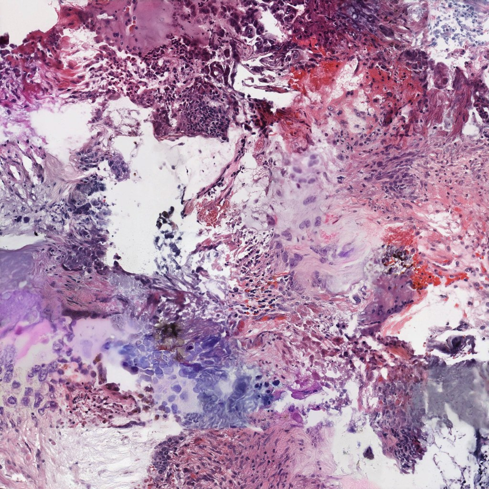

# SyncTweedies for DDPM and flow matching, in ComfyUI

A reimplementation of **SyncTweedies** (Kim et al., NeurIPS 2024) as a regular ComfyUI sampler, extended to a
**flow matching** model (FLUX 3 Klein) and applied to **histology** with PixCell.

A diffusion model generates images at a fixed resolution. To get a much larger image (a 3072 x 512 panorama, a
2048 x 2048 tissue slide), the canvas is split into overlapping views, every view is denoised by the model, and the
views are synchronised at each step so that they agree on their overlaps.



*SD 2 base, 3072 x 512, 21 views of 512 px, 50 DDIM steps, same seed. Without synchronisation each view lives its
own life and the seams are visible. The evolution of $\hat x_0$ during sampling is in [assets/sd2_trajectory.webp](assets/sd2_trajectory.webp).*

## Method

Each view $i$ is a crop $C_i$ of the canvas. ComfyUI uses $x = a(\sigma)\,x_0 + \sigma\,\epsilon$, with
$a(\sigma) = 1$ for eps-prediction models (SD 2, PixCell) and $a(\sigma) = 1 - \sigma$ for flow models (FLUX).

At each step $\sigma \to \sigma'$:

$$\hat x_{0,i} = D(x_i, \sigma) \qquad \text{(model + CFG + Tweedie, per view)}$$

$$\hat X_0 = \frac{1}{N(p)} \sum_i C_i^\top\, \hat x_{0,i} \qquad \text{(average on the overlaps)}$$

$$\bar x_{0,i} = C_i\, \hat X_0, \qquad \bar\epsilon_i = \frac{x_i - a(\sigma)\, \bar x_{0,i}}{\sigma}, \qquad x_i' = a(\sigma')\, \bar x_{0,i} + \sigma'\, \bar\epsilon_i$$

The noise of each view is **recomputed** from the synchronised $\hat x_0$. Keeping the view's own
$\hat\epsilon_i$ instead makes neighbouring views drift apart, and the result looks like a patchwork.

Three modes are available in the *SyncTweedies Sampler* node:

| mode | what is averaged |
|---|---|
| `independent` | nothing (baseline) |
| `multidiffusion` | $x_{t-1}$, after each view's own step (Bar-Tal et al., 2023) |
| `synctweedies` | $\hat x_0$, before the step (Kim et al., 2024) |

For plain crops the two synchronised modes give the same result, because the step is linear in $\hat x_0$ and $x$
(checked numerically, difference around $10^{-16}$). They differ when the map from views to canvas is not a crop,
for example a 3D texture seen from several cameras.

### Flow matching

The paper only uses eps-prediction models. A flow model predicts a velocity $\hat v$, and ComfyUI turns it into
$\hat x_0 = x - \sigma \hat v$, which is still an estimate of $\mathbb{E}[x_0 \mid x]$. Only the noise path changes,
$x = (1-\sigma)\,x_0 + \sigma\,\epsilon$, so the update above holds with $a(\sigma) = 1 - \sigma$:

$$x_i' = (1 - \sigma')\,\bar x_{0,i} + \sigma'\,\bar\epsilon_i = x_i - (\sigma - \sigma')\,\bar v_i$$

which is exactly an Euler step of the flow ODE. The flow case is detected from the model, nothing else changes.


*FLUX 3 Klein (distilled, 16 steps, CFG 1), 3072 x 1024, 9 views of 1024 px.*

Caveat: Klein is a distilled model, so its $\hat x_0$ is only approximately a conditional expectation.

### Histology with PixCell

[PixCell](https://arxiv.org/abs/2506.05127) is a PixArt-like DiT trained on TCGA tiles, with an SD3 VAE latent and
eps prediction. It is not a ComfyUI model, so it has its own loader / denoiser / sampling / decode nodes, but it
uses the same *Views* and *Synchronisation* nodes. Here the generation is unconditional (learned empty embedding).



*PixCell-256, 2048 x 2048, 11 x 11 views of 256 px, stride 192.*

The synchronisation removes the seams, but without conditioning the tissue type changes from one region to the next.
A natural next step is to condition each view on its own embedding (UNI-2h), as in Graikos et al. (CVPR 2024).

## Install

```bash
cd ComfyUI/custom_nodes
git clone https://github.com/Aureleee/synctweedies-flow
pip install -r synctweedies-flow/requirements.txt      # only needed for PixCell
```

Models:

| workflow | files | where |
|---|---|---|
| `sd2_panorama.json` | `512-base-ema.safetensors` | `models/checkpoints` |
| `flux3klein_panorama.json` | `flux3-image-klein-bf16.safetensors`, `qwen3vl_4b_bf16.safetensors`, `flux2-vae.safetensors` | `models/diffusion_models`, `text_encoders`, `vae` |
| `pixcell_grid.json` | `PixCell-256/`, `PixCell-SD3-VAE/` (diffusers format) | `models/diffusers` |

Then load a workflow from `workflows/`. `all_models.json` puts the three side by side (only SD 2 is active).

Standalone scripts, without the ComfyUI graph:

```bash
python scripts/run_sd2.py --comfyui /path/to/ComfyUI --mode synctweedies
python scripts/run_pixcell.py --models /path/to/ComfyUI/models/diffusers --mode synctweedies
```

`run_sd2.py` writes out every step (schedule, CFG, Tweedie, DDIM step) and only uses ComfyUI to load the weights.

## Files

```
sync_core.py      views, averaging and the synchronised sampling loop (pure torch)
nodes.py          SyncTweedies Views / SyncTweedies Sampler, plugged into SamplerCustomAdvanced
pixcell_nodes.py  PixCell loader, denoiser, schedule, sampling, decode
scripts/          standalone versions
workflows/        ComfyUI workflows
```

Tested on an Apple M-series Mac (MPS, 24 GB).

## References

- Kim, Lee, Sung. *SyncTweedies: A General Generative Framework Based on Synchronized Diffusions.* NeurIPS 2024.
- Bar-Tal, Yariv, Lipman, Dekel. *MultiDiffusion.* ICML 2023.
- Lipman et al. *Flow Matching for Generative Modeling.* ICLR 2023.
- Yellapragada, Graikos et al. *PixCell.* arXiv 2506.05127, 2025.
- Graikos et al. *Learned representation-guided diffusion models for large-image generation.* CVPR 2024.

## License

Code under MIT. The models keep their own licenses (Stable Diffusion 2, FLUX 3 Klein, PixCell is CC BY-NC-ND).
